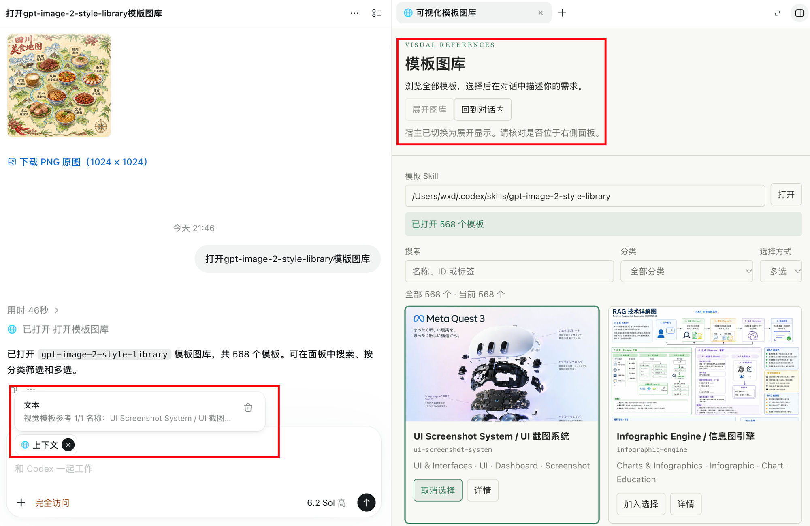
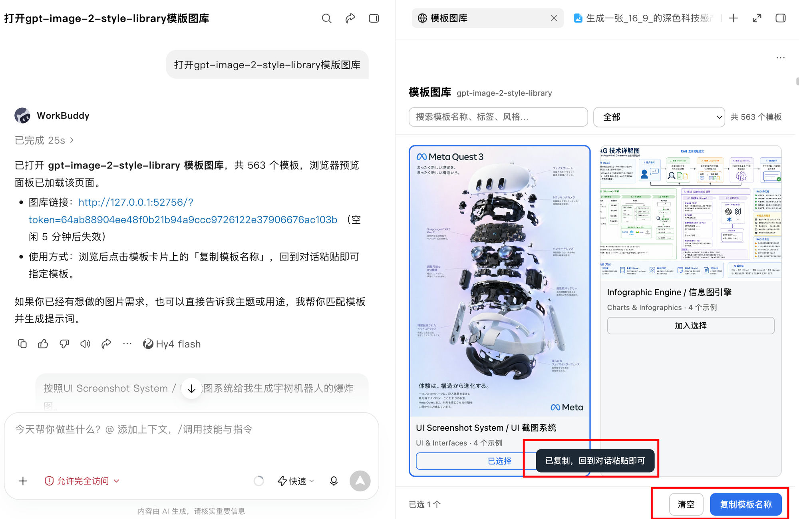

# Visual Template Gallery · 可视化模板图库

A **local, read-only** template gallery MCP service: browse every official example image of a template Skill, pick one or more templates as conversation reference, and use them to guide image, web, video and design tasks. It never generates preview images, never sends messages, and never modifies the composer.

[中文版本](README.md) · [Chinese version](README.md)

<div align="center">
  
  
  <p><sub>Left: native panel edition (Codex client) · Right: web compatible edition (WorkBuddy client)</sub></p>
</div>

---

## Two MCP services

This project ships the same "Visual Template Gallery" as **two MCP services**, one for clients with a native MCP App panel and one for clients without. Both share the same template parsing and source-fallback logic, but differ in tool surface and interaction.

| | Service 1: native panel (`native-panel`) | Service 2: web compatible (`web-compatible`) |
|---|---|---|
| Directory | [`native-panel/`](native-panel/) | [`web-compatible/`](web-compatible/) |
| Version | 0.2.x | 0.3.x |
| Target clients | Codex, Claude Code | WorkBuddy, Trae |
| Interaction surface | Host-hosted HTML MCP App panel | Local read-only web page (127.0.0.1) |
| MCP tools | 8 (incl. select / preview / clear / diagnostics) | 2 (open gallery / list skills) |
| Conversation reference | Submitted via `ui/update-model-context`, confirmed by host receipt | User copies the template name back into the chat |
| Minimum requirements | Codex ≥ `26.1023.51421`, Node ≥ 20 | WorkBuddy ≥ 5.0.0, Node ≥ 20 |

### Service 1: native panel (`native-panel/`) — Codex / Claude Code

For hosts that support the **MCP Apps panel**. Installed as a Codex plugin, the model calls `open_template_gallery` and the gallery renders in the host's right-side panel: pagination, search, category filter, details, single/multi selection. The selection is submitted as passive visual reference through `ui/update-model-context`; after generating, call `clear_template_context` to clear it.

**MCP server**: `visual-template-gallery` (stdio)

**Tools**:

| Tool | Description |
|---|---|
| `open_template_gallery` | Show all templates of a target Skill in the MCP App; with no args, shows the Skill picker |
| `get_template_gallery` | Read full template data of the open gallery (App-only loading) |
| `list_template_skills` | List local Skills for selection |
| `select_templates` | Validate the selection and build passive visual reference context (does not trigger generation) |
| `get_template_preview` | Read a template's official GitHub example images, with caching and source fallback |
| `get_selected_templates` | Read the gallery session's template references (App-only polling) |
| `clear_template_context` | Clear the current conversation's template selection and reference context after finishing |
| `report_app_state` | Local diagnostics (host mount / display-mode negotiation results) |

Installation:

```bash
cd native-panel
npm install
npm run build
codex plugin marketplace add "$(pwd)"
codex plugin add visual-template-gallery@visual-template-local
```

See [`native-panel/README.md`](native-panel/README.md).

### Service 2: web compatible (`web-compatible/`) — WorkBuddy / Trae

For hosts **without** an MCP Apps panel. When the model calls `open_template_gallery`, the plugin starts a **read-only web gallery** locally (listens on 127.0.0.1 only, auto-closes when idle). The user browses templates in the browser and copies the template name back into the chat.

**MCP server**: `visual-template-gallery` (stdio)

**Tools**:

| Tool | Description |
|---|---|
| `open_template_gallery` | Start a local read-only web gallery, list all templates and official example images of a Skill, and return a link with an expiry window |
| `list_template_skills` | List local Skills containing templates within allowed directories, for disambiguation |

Installation (from source):

```bash
cd web-compatible
npm install
npm run build
```

For WorkBuddy, use the prebuilt connector: `web-compatible/connector-package/visual-template-gallery-connector-v0.3.0.zip` (includes `connector-meta.json`, `token-schema.json`, `icon.svg`, and a prebuilt `server.mjs`).

See [`web-compatible/README.md`](web-compatible/README.md).

---

## Repository structure

```
visual-template-gallery/
├── README.md / README.en.md      # this document (Chinese / English)
├── docs/images/                  # project hero images
│   ├── codex-native-panel.jpg    # native panel edition (Codex)
│   └── workbuddy-web.jpg         # web compatible edition (WorkBuddy)
├── native-panel/                 # MCP service 1: native panel (Codex / Claude Code)
└── web-compatible/               # MCP service 2: web compatible (WorkBuddy / Trae)
```

---

## Key features

- **Browse every official example image**: pagination, search, category filter, details, single and multi selection.
- **Use as conversation reference**: the panel edition syncs through the host; the web edition relies on copying template names — neither requires copying prompts.
- **Read-only and safe**: the gallery only reads local Skills and official GitHub example images (cached); it does not generate previews, send messages, or modify the composer.
- **Flexible sources**: supports Markdown titles/names/IDs, template tables, minimal image rows and GitHub images, HTML images, Cover/Preview, Example cases, plus `manifest` and `theme.json`; an ID is derived from the name when missing.

## Template sources & boundaries

Skill authors are not required to adopt this project's manifest. Images are read from official GitHub examples first and cached; previews are never generated. Only explicit template names or IDs are ingested; brand images, badges and generic README images are filtered out. Dynamic pages, un-landed remote assets, or ambiguous name-image relations require an index — **full automatic recognition of every GitHub Skill is not promised**.

## Development & verification

Each sub-project builds and tests independently (run inside the respective directory):

```bash
npm install
npm run build      # build and emit the release bundle to plugins/visual-template-gallery
npm test           # unit tests
npm run typecheck  # type check
```

- `native-panel/` additionally provides `npm run test:app-host` (port-4180 protocol test host), `npm run doctor` (client-consistency self-check) and `npm run prune` (keep only the latest version).
- `web-compatible/`'s release bundle `plugins/visual-template-gallery/server.mjs` is a build artifact (excluded in `.gitignore`); run `npm run build` before installing. The prebuilt connector lives under `connector-package/`.

---

## FAQ

**Which service should I use?** If your client can host a native MCP App panel (Codex / Claude Code), use `native-panel/`; otherwise (WorkBuddy / Trae), use `web-compatible/`.

**Does the gallery upload anything?** No. It only reads local directories and official GitHub example images; path configuration is stored locally.

**Why doesn't the web edition inject the selection automatically?** Hosts without a panel have no host-sync channel, so the web edition only provides a read-only page and the user copies the template name back into the chat.

---

## Notes

- Each sub-project's design and acceptance records live under its `docs/` directory (architecture, product design, ADRs, acceptance logs).
- This repository is a unified packaging and documentation entry point; the two sub-projects keep their own build and version cadence.
