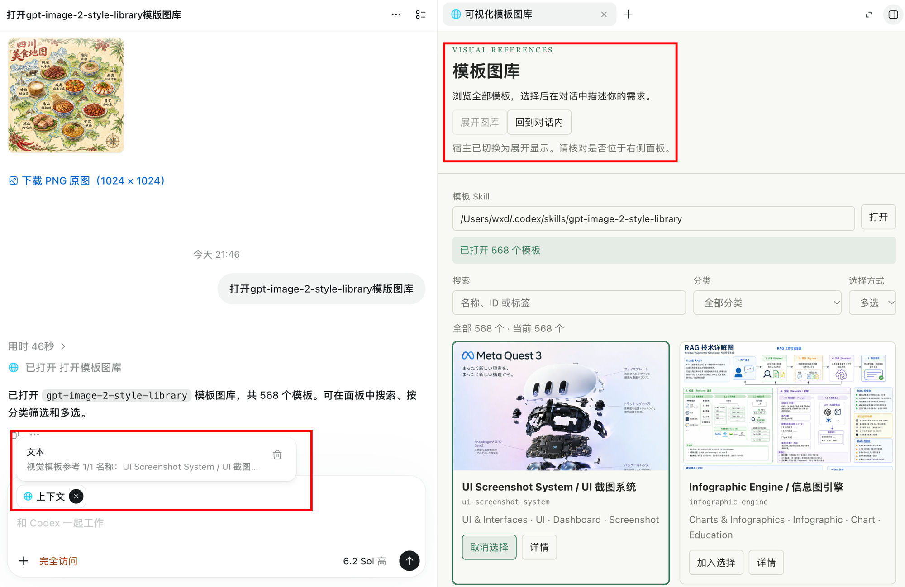
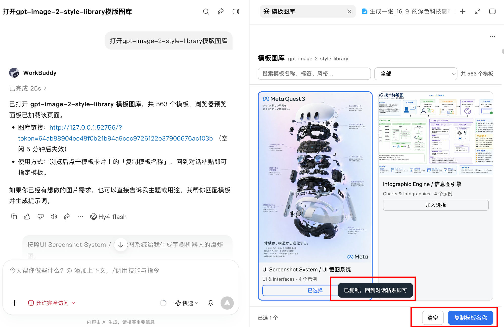

# 可视化模板图库 · Visual Template Gallery

一个**本地只读**的模板图库 MCP 服务：浏览任意模板 Skill 的全部官方示例图，手动选择模板作为对话参考，辅助生图、网页、视频与设计任务。不生成预览图、不发送消息、不修改输入框。

[English version](README.en.md) · [English 版本](README.en.md)

<div align="center">
  
  
  <p><sub>左：原生面板版（Codex 客户端截图）　右：网页兼容版（WorkBuddy 客户端截图）</sub></p>
</div>

---

## 两个 MCP 服务

本项目把同一个「可视化模板图库」做成了**两个 MCP 服务**，分别适配「有原生 MCP App 面板」和「无原生面板」两类客户端。两者共用同一套模板解析与来源回退逻辑，但工具集与交互方式不同。

| | 服务 1：原生面板版（native-panel） | 服务 2：网页兼容版（web-compatible） |
|---|---|---|
| 目录 | [`native-panel/`](native-panel/) | [`web-compatible/`](web-compatible/) |
| 版本 | 0.2.x | 0.3.x |
| 目标客户端 | Codex、Claude Code | WorkBuddy、Trae |
| 交互载体 | 宿主承载的 HTML MCP App 面板 | 本地只读网页（127.0.0.1） |
| MCP 工具 | 8 个（含选择/预览/清除/诊断） | 2 个（打开图库 / 列出 Skill） |
| 对话参考 | 面板经 `ui/update-model-context` 提交，宿主回执确认 | 用户复制模板名称粘贴回对话 |
| 最低要求 | Codex ≥ `26.1023.51421`，Node ≥ 20 | WorkBuddy ≥ 5.0.0，Node ≥ 20 |

### 服务 1：原生面板版（`native-panel/`）— Codex / Claude Code

针对**支持 MCP Apps 面板**的宿主。安装为 Codex 插件后，模型调用 `open_template_gallery`，图库在宿主右侧面板内展示：分页、搜索、分类筛选、查看详情、单选/多选，选中后经 `ui/update-model-context` 提交为被动视觉参考，完成生图后调用 `clear_template_context` 清除。

**MCP Server**：`visual-template-gallery`（stdio）

**工具清单**：

| 工具 | 说明 |
|---|---|
| `open_template_gallery` | 在 MCP App 中展示目标 Skill 的全部模板；省略参数时显示 Skill 选择器 |
| `get_template_gallery` | 读取已打开图库的全部模板数据（仅供图库 App 加载） |
| `list_template_skills` | 列出本地 Skill 目录，供用户选择 |
| `select_templates` | 验证已选模板并构建被动视觉参考上下文（不触发生成） |
| `get_template_preview` | 读取模板的官方 GitHub 示例图，支持缓存与来源回退 |
| `get_selected_templates` | 读取图库会话的模板引用（仅供 App 轮询） |
| `clear_template_context` | 完成后清除当前对话的模板选择与参考上下文 |
| `report_app_state` | 本机诊断写入（宿主挂载 / 显示模式协商结果） |

安装：

```bash
cd native-panel
npm install
npm run build
codex plugin marketplace add "$(pwd)"
codex plugin add visual-template-gallery@visual-template-local
```

详见 [`native-panel/README.md`](native-panel/README.md)。

### 服务 2：网页兼容版（`web-compatible/`）— WorkBuddy / Trae

针对**没有 MCP Apps 面板**的宿主。模型调用 `open_template_gallery` 后，插件在本地启动一个**只读网页图库**（仅监听 127.0.0.1，空闲自动关闭），用户在网页里浏览模板并「复制模板名称」粘贴回对话。

**MCP Server**：`visual-template-gallery`（stdio）

**工具清单**：

| 工具 | 说明 |
|---|---|
| `open_template_gallery` | 在本地启动只读网页图库，列出目标 Skill 的全部模板与官方示例图，返回带失效时限的链接 |
| `list_template_skills` | 列出允许目录下含模板的本地 Skill，用于消歧 |

安装（源码构建）：

> **⚠️ 必须先执行 `npm run build`，否则装不起来。**
> `web-compatible/plugins/visual-template-gallery/server.mjs`（约 1.4 MB 的 esbuild 打包产物）按该项目 `.gitignore` **不纳入版本管理**。`git clone` 后 `plugins/visual-template-gallery/` 下只有 `mcp.json`、`SKILL.md`、`README.md` 三个文件，`server.mjs` 缺失，且 `mcp.json` 里的 `__INSTALL_DIR__/server.mjs` 仍是占位符——直接安装会因找不到入口文件而失败。

```bash
cd web-compatible
npm install
npm run build      # 必需：由 src/mcp/server.ts 生成 plugins/.../server.mjs
```

不想构建也可以——WorkBuddy 用户直接用预打包连接器，其中已含构建好的 `server.mjs`：`web-compatible/connector-package/visual-template-gallery-connector-v0.3.0.zip`（含 `connector-meta.json`、`token-schema.json`、`icon.svg` 与 `server.mjs`）。

详见 [`web-compatible/README.md`](web-compatible/README.md)。

---

## 仓库结构

```
visual-template-gallery/
├── README.md / README.en.md      # 本说明（中文 / 英文）
├── docs/images/                  # 项目首图
│   ├── codex-native-panel.jpg    # 原生面板版（Codex）
│   └── workbuddy-web.jpg         # 网页兼容版（WorkBuddy）
├── native-panel/                 # MCP 服务 1：原生面板版（Codex / Claude Code）
│   └── plugins/.../server.mjs    # ✅ 已提交（含手工「无 thread 绑定」补丁）
└── web-compatible/               # MCP 服务 2：网页兼容版（WorkBuddy / Trae）
    ├── plugins/.../server.mjs    # ❌ 未提交，需 npm run build 生成
    └── connector-package/        # ✅ 预构建连接器，含可直接运行的 server.mjs
```

两个子项目对 `server.mjs` 的处理不同：`native-panel/` 把它纳入版本管理（内含会被构建覆盖的手工补丁，丢失会丢功能）；`web-compatible/` 视其为纯构建产物而排除，改用 `connector-package/` 提供即用副本。

---

## 核心能力

- **浏览全部官方示例图**：分页、搜索、分类筛选、详情，支持单选与多选。
- **作为对话参考**：面板版经宿主同步提交，兼容版靠复制模板名称——都不需要复制提示词。
- **只读安全**：图库只读取本地 Skill 与官方 GitHub 示例图并缓存，不为预览生图，不发消息，不修改输入框。
- **来源兼容**：支持 Markdown 标题/名称/ID、模板表格、最简图片行与 GitHub 图片、HTML 图片、Cover/Preview、Example cases，也兼容 manifest、theme.json；无 ID 时从名称生成。

## 模板来源与边界

不要求 Skill 作者采用本项目 manifest。图片优先读取官方 GitHub 示例并缓存，不为预览生图。只有明确的模板名称或 ID 才会接入；Skill 品牌图、徽标和通用 README 图片会过滤。动态网页、远端资料未落地或图片与名称关系不明确时需补充索引，**不承诺所有 GitHub Skill 自动完整识别**。

## 开发与验证

两个子项目各自独立构建与测试（进入对应目录执行）：

```bash
npm install
npm run build      # 构建并生成发行包到 plugins/visual-template-gallery
npm test           # 单元测试
npm run typecheck  # 类型检查
```

- `native-panel/` 额外提供 `npm run test:app-host`（4180 协议测试宿主）、`npm run doctor`（客户端一致性自检）、`npm run prune`（只保留最新版本）。
- `web-compatible/` 的发行包 `plugins/visual-template-gallery/server.mjs` 为构建产物（已在 `.gitignore` 中排除，仓库里不存在），**安装前必须** `npm run build`；无需构建的场景请改用 `connector-package/` 里的预构建连接器。

---

## 常见问题

**两个服务如何选？** 你的客户端若能挂载原生 MCP App 面板（Codex / Claude Code），用 `native-panel/`；否则（WorkBuddy / Trae）用 `web-compatible/`。

**图库会不会上传内容？** 不会。图库只读取本机目录与官方 GitHub 示例图，路径配置仅保存在本机。

**为什么不自动把选择注入对话（兼容版）？** 无面板宿主没有宿主同步通道，兼容版只提供只读网页，由用户复制模板名称带回对话。

**clone 后插件起不来 / 提示找不到 `server.mjs`？** 正常现象。`web-compatible/plugins/` 下不含构建产物，先 `cd web-compatible && npm install && npm run build` 生成；或直接改用 `connector-package/` 里的预构建连接器。详见上文[服务 2 安装说明](#服务-2网页兼容版web-compatible--workbuddy--trae)。

---

## 说明

- 各子项目的设计与验收记录见其 `docs/` 目录（架构、产品设计、ADR、验收记录）。
- 本项目仓库仅作统一打包与文档入口，两个子项目各自保持独立的构建与版本节奏。
